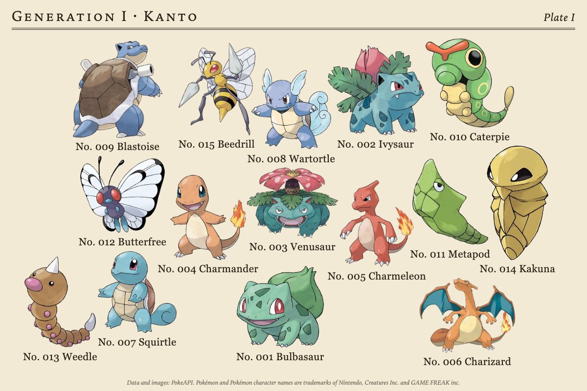
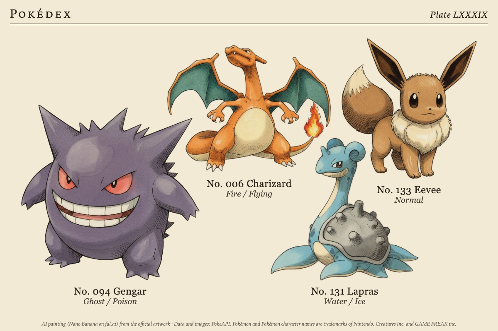
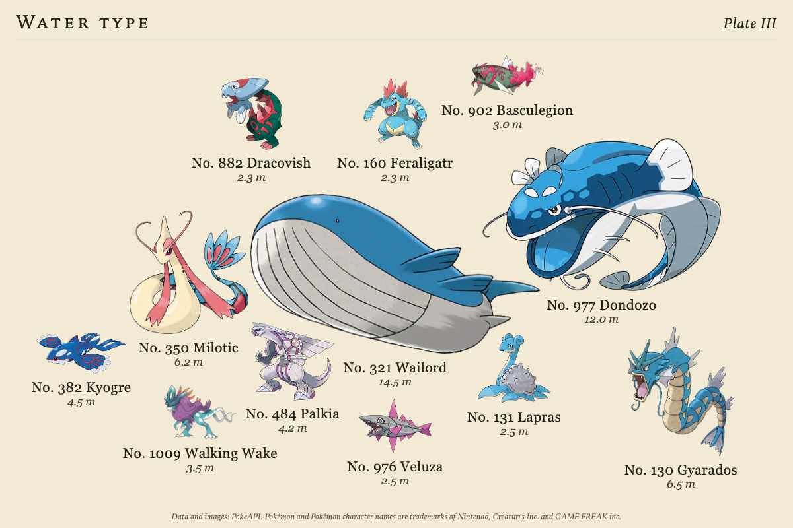
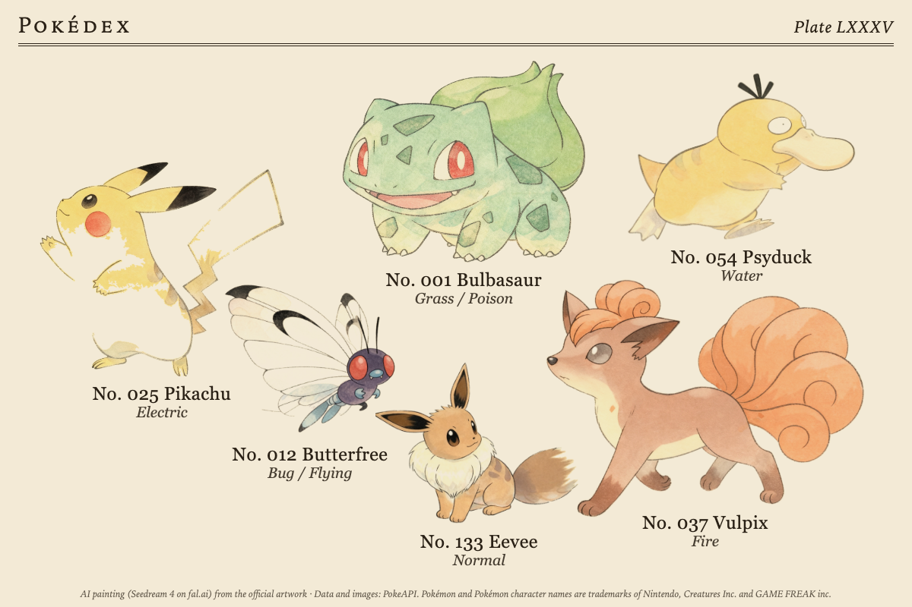
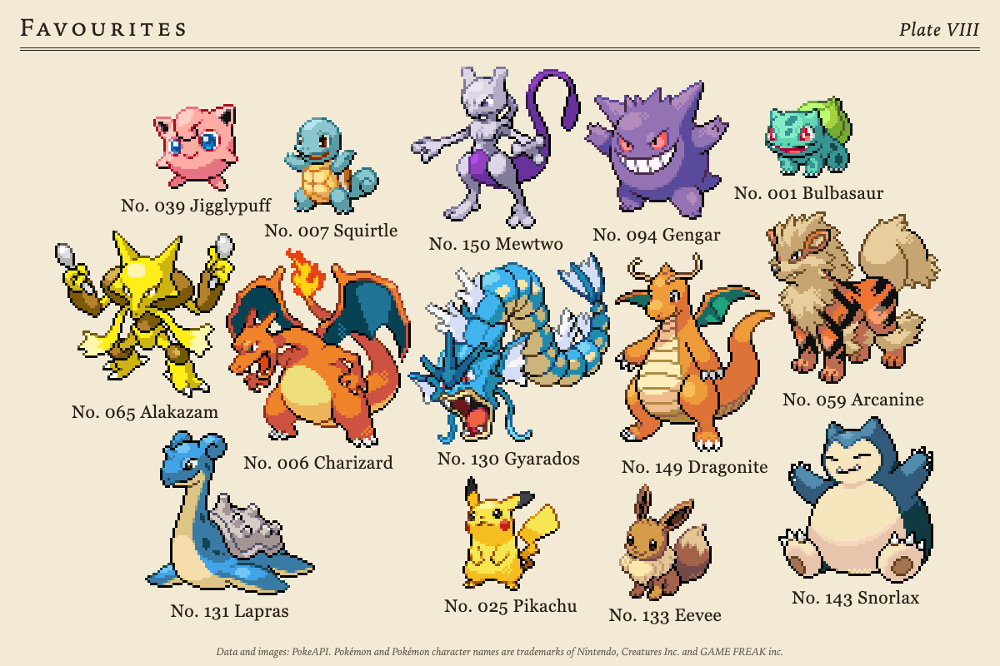
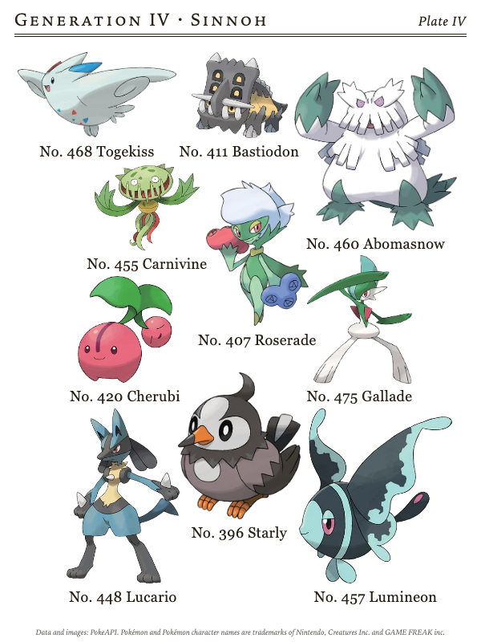
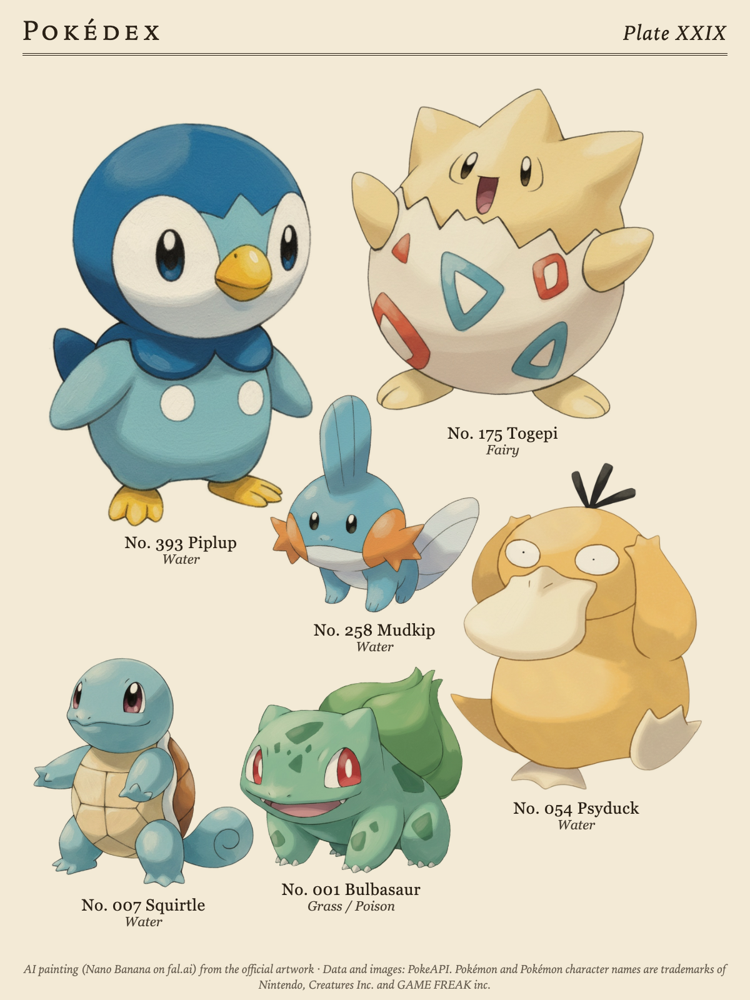
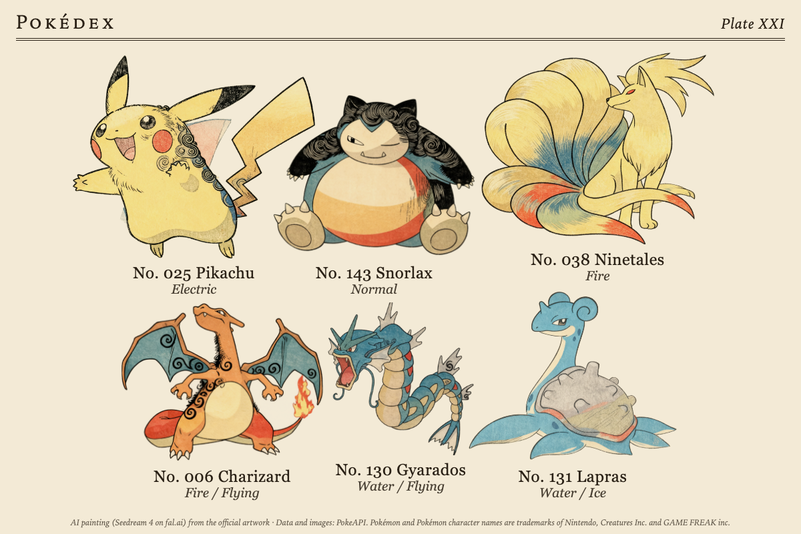
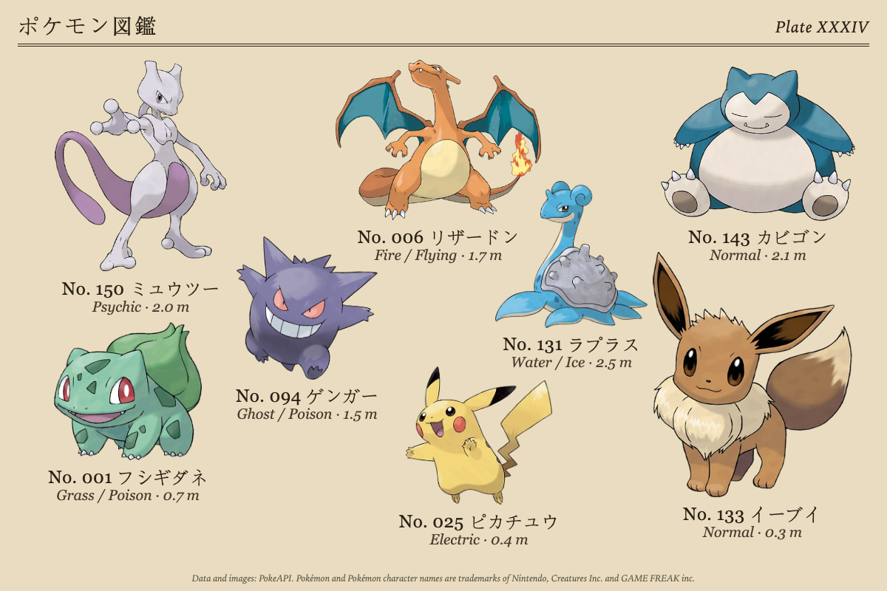
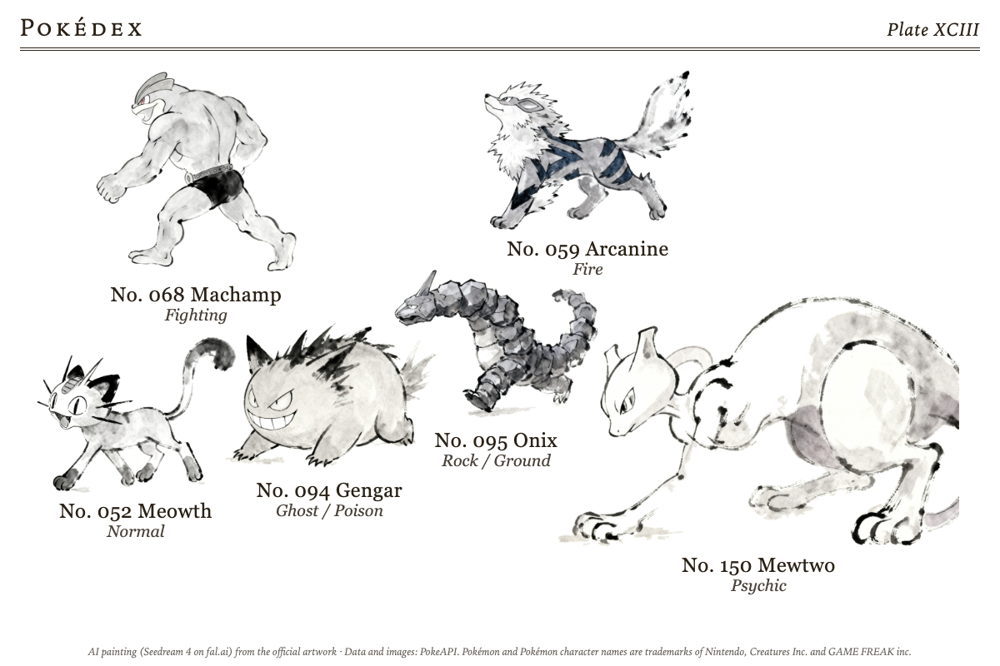

# pokedex_plate

Pokémon packed onto one printed page like a natural-history specimen sheet:
each cut out and as large as the page allows, with its National Pokédex number
and name beneath, a title and a plate number at the top, and the credits at
the foot.

## Where the Pokémon come from

Everything comes from [PokeAPI](https://pokeapi.co), which needs no key:

- **A generation**: one of the nine, Kanto to Paldea.
- **A type**: any of the eighteen.
- **Random**: a different sheet from the whole National Pokédex every day.
- **Your list**: a team or favourites, typed as names or numbers, one per line
  or separated by commas (`Pikachu, #6, 143, Mr. Mime, Farfetch'd`). Anything
  PokeAPI does not know is skipped and named at the foot of the plate.

For a generation or a type, **Pick** chooses which of the group make the plate:
a random pick that changes once a day (the default), the first in Pokédex
order, or the tallest of the group. The random picks are seeded by the date,
so every render on the same day is identical and a battery panel is not woken
for a picture that has not changed.

Each Pokémon brings its number, its name (in English or one of the other
languages PokeAPI carries: Japanese in kana or romaji, German, French, Spanish,
Italian, Korean, simplified Chinese), its types and its height.

## Pictures

The widget bundles no Pokémon images. Every picture is fetched at runtime from
PokeAPI's sprite repository (raw.githubusercontent.com/PokeAPI/sprites) and
kept in the widget's data folder.

**Pixel sprites** (the default) are the 96 px game sprites, cropped to their
pixels and drawn at whole-number scales with no smoothing, so they stay crisp
on e-paper. With "About the same size" every sprite keeps one pixel scale, as
the games draw them.

**Official artwork** is the large painted artwork, cut out by its own
transparency.

**AI paintings** repaint each Pokémon once from its official artwork, through
the host's artwork collection (Tesserae 0.463 or later, with a fal.ai key in
this widget's settings or a key under Settings, Generative AI). The painter is
asked for the whole creature alone, its true colours, markings and proportions
kept, on plain white paper with no background, text, border or shadow. The
painting's paper is then cut away (white inside the creature stays) and it is
cropped to the creature, so it sits on the plate's paper as if printed there.
Until a painting lands the official artwork shows, and the editors poll while
the work is on the way. A painting is kept and never paid for twice; the
paintings page at `/plugins/pokedex_plate/artwork/paintings/` lists them with
Repaint and Delete. Each costs about US$0.03 with Seedream 4, the default, within
a daily budget you set.

Each Pokémon is drawn afresh in a pose of its own, not the official artwork with a
filter on it: the artwork is only the reference for what it looks like. Seedream 4
redraws most freely; Nano Banana and GPT Image 2 keep closer to the artwork, and
some models may refuse a well-known character outright, in which case the
official artwork stays on the plate.

Nine styles: Victorian engraving, hand-coloured (the default); naturalist's
watercolour field study; three Japanese ones, an Edo-period woodblock print
(ukiyo-e) after Hokusai and Kuniyoshi, a shin-hanga nature print (kachō-e) after
Ohara Koson and a Chōjū-giga ink scroll after the twelfth-century animal scrolls;
sumi-e ink painting; linocut print; scientific line drawing; children's-book
gouache. Sumi-e, the Chōjū-giga scroll and the line drawing are black ink only,
the ones for a black and white panel.

## Sizes and packing

**About the same size** gives every picture about the same room on the page.
**By real height** scales each by its Pokédex height, so Wailord dwarfs Joltik;
the smallest is held to a quarter of the tallest so it stays visible.

The packer is the Specimen Sheet widget's: each picture's outline (not its
box) is laid on a fine grid with its caption strip under it, the largest are
placed first from the middle out, and the arrangement is grown into the room
left. **Balanced** (the default) grows each picture into the space round it;
**Spiral** makes a round cluster; **Voids** spreads the large ones over the
page and fills the gaps with the small ones. Captions are measured in the font
they are drawn in, and a crowded small cell keeps only the first caption line.

## Built for e-ink

The paper (cream, white or aged) is literal, as a printed page is. The
**Panel** option prepares the pictures for what the panel can show: sprites
snap to the panel's own greys (16 or 4), or on black and white are thresholded
to clean black line art with nothing left to dither; artwork and paintings are
converted to grey and contrast-stretched. Greyscale and black and white panels
print on white paper, and on black and white the captions are set in a bold
sans. Nothing animates and no webfont is loaded.

## Options

Which Pokémon, pictures, sizes and captions are always shown; the rest appear
with the choice they depend on or sit under **More options**.

| Option | Notes |
| --- | --- |
| Which Pokémon | A generation, a type, Random (a new sheet each day), or Your list. |
| Generation | With a generation: I Kanto to IX Paldea. |
| Type | With a type: the eighteen types. |
| Pokémon | With Your list: names or numbers, up to 24. |
| How many | 1 to 24, default 12 (not for a list). |
| Pick | With a generation or a type: random each day (default), Pokédex order, or largest first. |
| Pictures | Pixel sprites (default), official artwork, or AI paintings. |
| Style | With AI paintings: the nine styles above. |
| Sizes | About the same size (default), or by real height. |
| Captions | Any of number, name, types, height. Default number and name. |
| Packing | More options. Balanced (default), spiral, or voids. |
| Names in | More options. English (default) or one of eight other languages. |
| Paper | More options. Cream, white or aged. |
| Panel | More options. Colour, 16 greys, 4 greys, or black and white. |
| Model | More options, with AI paintings. Nano Banana (default), Nano Banana Pro, FLUX.1 Kontext Pro, GPT Image 2, Seedream 4. |
| Title | More options. Overrides the title (the generation, the type, or the day). |
| Credits | More options. The PokeAPI credit and trademark notice, and the model behind any paintings; on by default. |

Settings (one set for every cell): the fal.ai key, a painting budget per day
(default US$2), and how many new paintings one preview may start (default 3).

## Being polite to PokeAPI

PokeAPI is a free community service. The widget sends a User-Agent naming this
repository, keeps each Pokémon's record for thirty days (only the few fields it
uses, not the full answer), keeps every picture for good, remembers a miss for
a day, and makes at most 60 new data calls in one refresh; anything left over
arrives on the next. A generation needs no list call at all, and "Largest
first" asks PokeAPI's GraphQL endpoint once for the whole group. When PokeAPI
cannot be reached and nothing is cached, the plate shows a sample sheet of
names without pictures and says so.

## Screenshots

| | |
| --- | --- |
|  |  |
| Generation I in Pokédex order, official artwork, 1200x800 | A list of favourites in pixel sprites at one scale, 1200x800 |
|  |  |
| Water type, largest first, by real height, 1200x800 | Generation IV on white paper, portrait half panel, 600x800 |
|  |  |
| AI paintings (Nano Banana), Victorian engraving, 1200x800 | AI drawings (Seedream 4), shin-hanga nature print (kachō-e), 1200x800 |
|  |  |
| AI paintings (Nano Banana), children's-book gouache, 13.3" portrait, 1200x1600 | AI drawings (Seedream 4), Edo-period woodblock print (ukiyo-e), 1200x800 |
|  |  |
| Names in Japanese with types and heights, aged paper, 1200x800 | AI drawings (Seedream 4), Chōjū-giga ink scroll, black ink only, white paper, 1200x800 |

## Development

`tests/` runs offline: PokeAPI is a fake, pictures are drawn with Pillow, and
the AI path runs against a stub collection. `tools/preview.py` renders a cell
through `server.fetch()` and `client.js` in Chromium (Playwright), with a
Tesserae checkout on `PYTHONPATH` for `app.artwork`:

    PYTHONPATH=../tesserae python tools/preview.py --w 800 --h 480 source=type poke_type=water

## Licence and trademarks

AGPL-3.0. See [LICENSE](LICENSE). The packer in `static/pack.js` comes from
the Specimen Sheet widget, and its spiral and voids layouts from Arne Giacomo
Munthe-Kaas's Fugleramme (MIT; the notice is kept in the file).

Data and images: [PokeAPI](https://pokeapi.co). Pokémon and Pokémon character
names are trademarks of Nintendo, Creatures Inc. and GAME FREAK inc. This
widget is not affiliated with or endorsed by them. It contains no Pokémon
images: the sprites and official artwork are fetched at runtime from PokeAPI,
and the screenshots in this repository show what the widget draws from them.
